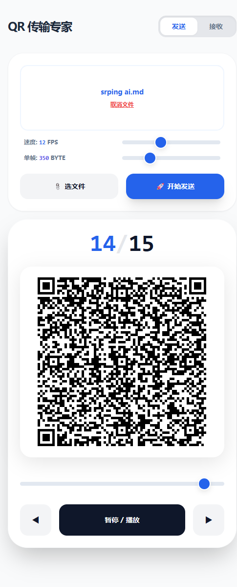

# AirScan-QR-Plus 📡

**物理隔离 / 内网环境下的文件传输工具**：屏幕显示动态二维码 → 手机摄像头扫描 → 自动重组下载。

不联网、不装驱动、不经服务器，数据不离开本地。适用于内网机器取文件、手机 ↔ 手机互传、
远程桌面 / VPN 穿透、无痕传输等场景。

> **基于 [topcss/AirScan-QR](https://github.com/topcss/AirScan-QR)（MIT）深度改造**，主要变化：
> - **协议 v2.0**：二进制帧 + 原始字节（去掉 base64 的 33% 冗余）+ 自动 zlib 压缩（文本类可压 5~10 倍）；
> - **终端发送端 `cli/`**：Windows / Linux × 64 / 32 位四份静态成品，无图形界面的内网服务器 SSH 上去就能发；
> - **接收端离线 / 老浏览器兼容**：零外链单文件、ES5、静态 CSS、解压器内联（pako）；
> - **缺帧补发闭环**：接收端一键导出缺帧号，发送端运行中直接粘贴补发；
> - **发送端与接收端需配套 v2.0**（不兼容原版协议）。

## 两个入口

| 入口 | 适用机器 | 说明 |
|---|---|---|
| [`index.html`](index.html) | 有图形界面 | 浏览器单文件，发送、接收都能做；**零外链，离线可用** |
| [`cli/`](cli/) | 无图形界面（服务器 / SSH） | 命令行发送端，在终端里直接显示二维码 |

两端协议一致（**v2.0**：二进制帧 + 原始字节 + 自动 zlib 压缩；网页端用等价的文本帧），任意组合互通。
文本 / 日志类文件通常能压到 1/5~1/10，帧数同比减少；已压缩文件（`.7z`/`.zip`）会自动跳过压缩。

## 快速开始

**发送（命令行，内网服务器）**

```sh
./cli/airscan-cli-linux-x86_64 要传的文件.zip --chunk 500 --fps 10   # Linux
cli\airscan-cli-win64.exe 要传的文件.zip                            :: Windows
```

`cli/` 里有四份开箱即用的成品：Windows / Linux × 64 / 32 位，静态链接或仅依赖系统自带
运行库，拷贝过去就能跑。加 `--dry-run` 可先预检终端放不放得下、估算要传多久。

**接收（手机）**

1. 把 `index.html` 传到手机，用浏览器打开；
2. 切到「接收」页 → 点「摄像头」→ 对准发送方屏幕；
3. 进度满后自动弹出「立即下载文件」。

> 摄像头需要 HTTPS 或 localhost（Firefox 55+ / Chrome 47+ 的限制）。直接打开本地文件一般
> 可用；不行就用 `https_server.py` 起个 HTTPS 服务（用法见文件内注释）。

 &nbsp; 

## 常用参数与调优

| 参数 | 说明 |
|---|---|
| `--chunk N` | 单帧数据量（16~2400，默认 200）：越大越快，但二维码越大、越难扫清 |
| `--fps N` | 帧率（1~60，默认 8） |
| `--dry-run` | 只估算不发送：放不放得下、耗时多久 |

实用区间 **chunk 350~800**；终端放不下时程序会直接告诉你改小到多少。

**丢帧不用重来**：接收端点「导出缺帧列表」拿到形如 `5,6,109` 的帧号，回到**正在运行的发送端**
直接把帧号粘贴进去按回车，就会只补发这几帧（按 `f` 恢复完整播放）：

```
[12/522] 8.0fps 200c/f v9 输入:5,6,109  ← 粘贴后回车
[补发 1/3] 帧5/522 8.0fps ...           ← 只循环这三帧
```

> 注意发送端**不要退出重开**（重开会换任务号，接收端会清空已收内容重来）。
> 发送端也支持手动操作：`空格` 暂停，`,` `.` 逐帧，`数字 + 回车` 跳到指定帧，`q` 退出。

## 兼容性

- **老浏览器 / 离线内网**：`index.html` 已做兼容改造——零外链单文件（二维码生成与解码库
  全部内联）、ES5 语法、静态 CSS，CentOS 6/7 自带的老 Firefox 直接打开即可用；
- **老系统**：CLI 四份成品覆盖 Windows 7+ 与 Linux（内核 2.6.32+），64 / 32 位齐全。

## 自行编译

源码、构建命令（musl / MSYS2 mingw / i486 交叉工具链）与验证记录见 [`cli/README.md`](cli/README.md)。

## 其他文件

- [`airscan-fountain.html`](airscan-fountain.html)：喷泉码四码同传实验版，抗丢帧、效率更高
  （感谢 [@YILS-LIN](https://github.com/YILS-LIN)）
- [`https_server.py`](https_server.py)：为摄像头场景提供 HTTPS 页面的辅助脚本

## 📜 许可证

MIT License © [Jack/topcss]（原项目 AirScan-QR）；改造部分 © ke0xa6。
详见 [LICENSE](LICENSE)。
